<picture>
  <source media="(prefers-color-scheme: dark)" srcset="./assets/banner-dark.svg" />
  <source media="(prefers-color-scheme: light)" srcset="./assets/banner-light.svg" />
  
</picture>

I build small tools for **Linux, AI and everyday problems**, from terminal apps
to desktop utilities. I like taking systems apart, learning how they behave, and bending
them to the way I work.

Right now I'm exploring **mobile systems and AI/LLM security** through authorized lab work.
Away from the keyboard: cars, racing games, and a curiosity about how things work that never really switched off.

### `~/projects`

- **[Clar Focus](https://github.com/talhacaglar/Clar-Focus)** — Tasks, Pomodoro and focus controls for Arch + Hyprland. `python` `textual` `sqlite`
- **[archsweep](https://github.com/talhacaglar/archsweep)** — An opt-in terminal cleaner for Arch-based systems. Small and direct. `bash`
- **[PrintHub](https://github.com/talhacaglar/PrintHub)** — Network printers, toner stock and Active Directory in one desktop app. `electron` `javascript`
- **[DTR](https://github.com/talhacaglar/tui-translator)** — Instant Turkish translation with DeepL, without leaving the terminal. `python` `deepl`
- **[Lexis](https://github.com/talhacaglar/Lexis)** — A personal, AI-assisted dictionary. `in progress`

[all repositories →](https://github.com/talhacaglar?tab=repositories)

### `~/setup`

`arch linux` · `hyprland` · `python` · `shell` · `typescript` · `sqlite` — [dotfiles](https://github.com/talhacaglar/dotfiles)

### `~/contact`

[portfolio](https://talhacaglar.github.io/) · [linkedin](https://www.linkedin.com/in/talhacaglar1/) · [email](mailto:talhacaglarr@proton.me) · [telegram](https://t.me/Cgllar) · discord <code>0ff0ff0ffoff</code>
